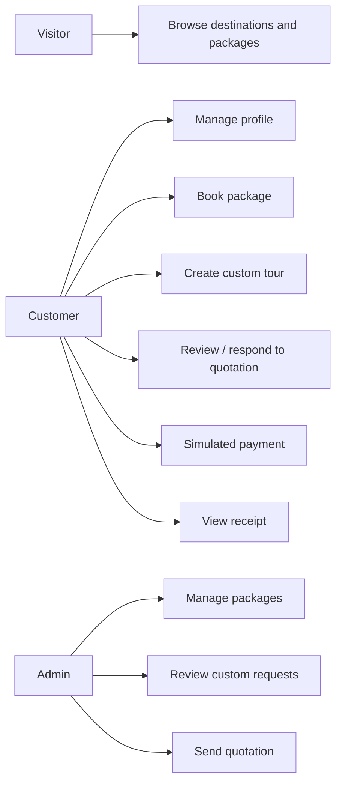
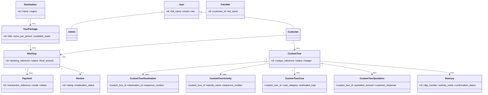
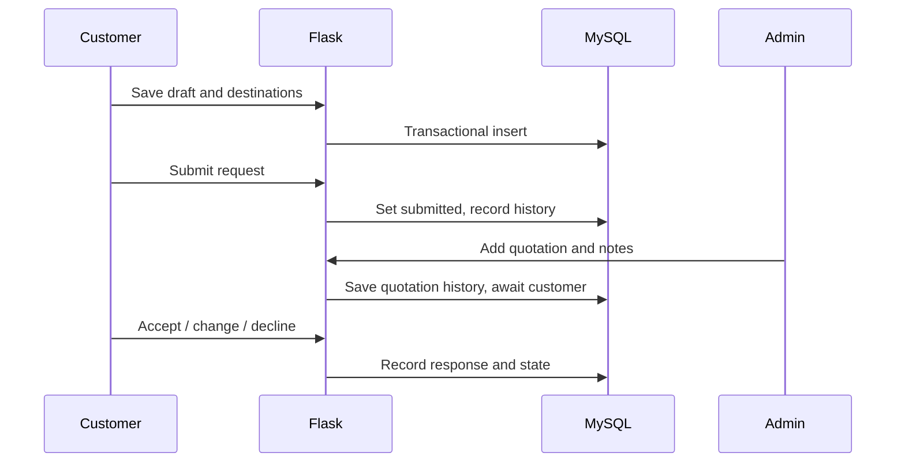
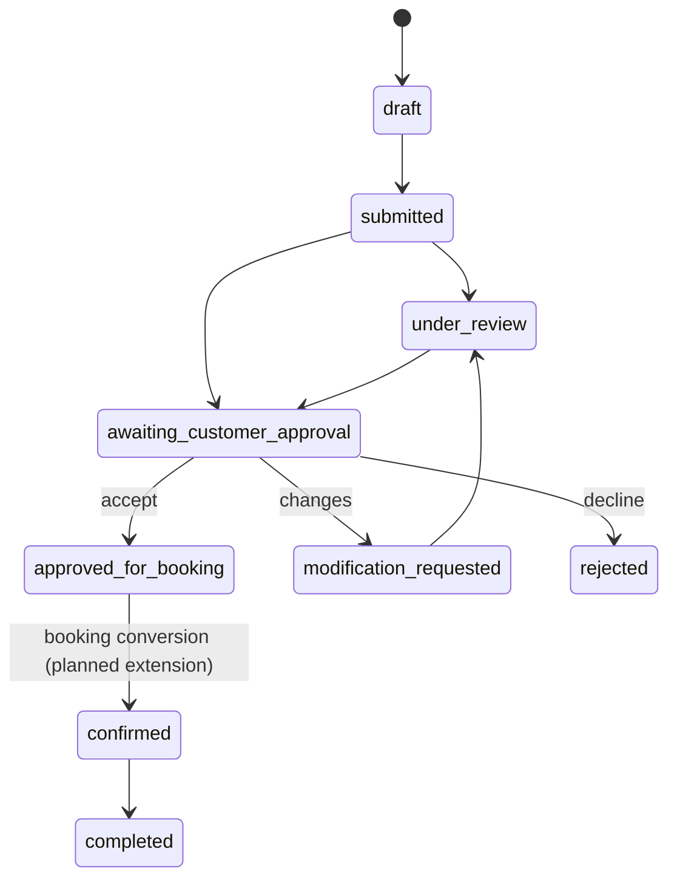
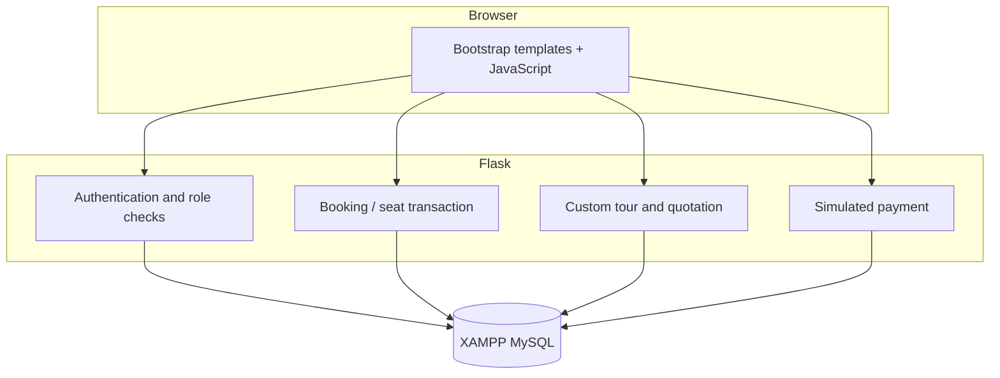
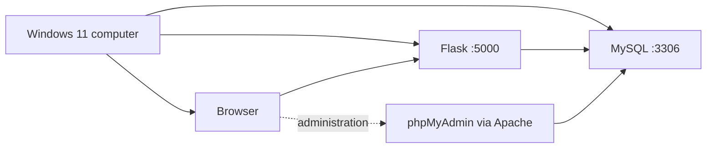
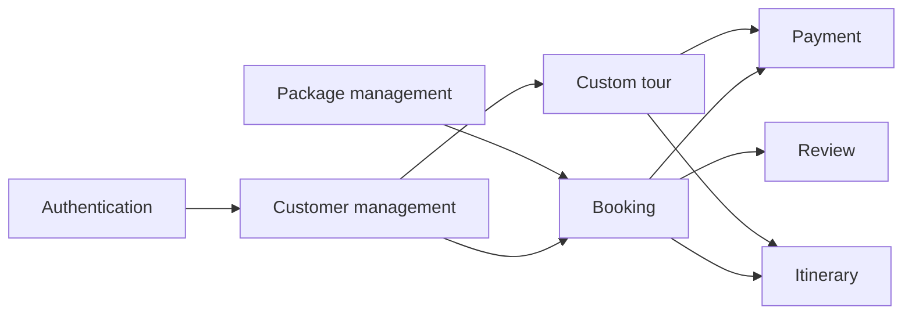
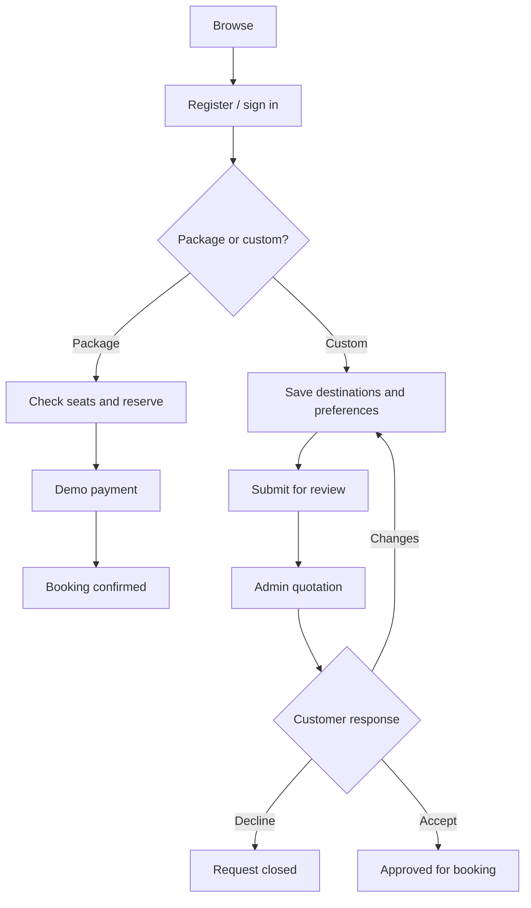
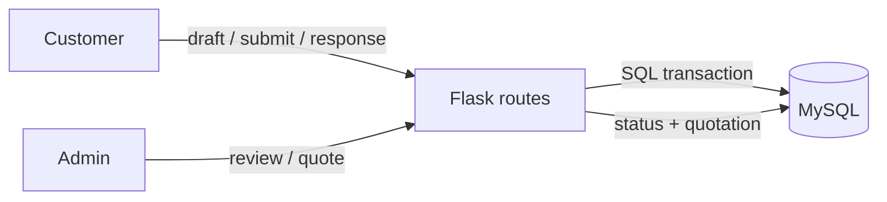

# Tour and Travel Booking Management System

A local Flask + MySQL (XAMPP) OOAD college project. It includes customer registration/profile, searchable packages, transactional seat allocation, a clearly simulated payment path, receipts, custom-tour drafts and submission, admin quotations, and package administration.

## Stack and important behavior

- Python 3.10+, Flask, `mysql-connector-python`, `python-dotenv`, Werkzeug password hashing.
- MySQL/InnoDB on XAMPP. There is no SQLite or in-memory persistent-data fallback.
- INR package prices in the catalogue are sample project data. Custom-tour amounts are customer budgets; no live rates are invented. An admin quotation is a manual proposal, not a provider availability guarantee.
- The payment action is simulated. It creates a `simulated` payment record and never charges money.
- Customer sessions and admin routes are role-checked. SQL values use parameters, and package-seat decrement/booking creation is one row-locked transaction.

## Windows 11 setup

1. Install Python 3 and XAMPP. Open XAMPP Control Panel and start **MySQL**. Start Apache if you want phpMyAdmin.
2. Open `http://localhost/phpmyadmin/`. Import `schema.sql` (it creates `tour_travel_booking`) and then import `seed.sql`.
3. In this project folder, create a virtual environment and install dependencies:

   ```powershell
   py -m venv .venv
   .\.venv\Scripts\Activate.ps1
   pip install -r requirements.txt
   Copy-Item .env.example .env
   ```

4. Edit `.env` to match your XAMPP MySQL host, port, username and password. A common local configuration is host `127.0.0.1`, port `3306`, user `root`; installations differ. Set `SECRET_KEY` to a long random value.
5. Verify connectivity: `py check_db.py`. On success it prints the selected database and MySQL version.
6. Create an administrator interactively: `py init_admin.py`. Choose a unique email and a password of at least 12 characters. No admin password is shipped in source.
7. Start the Flask development server: `py app.py`. Open `http://127.0.0.1:5000/`.

If the MySQL port or password differs, change `DB_PORT` or `DB_PASSWORD` in `.env`, and rerun `py check_db.py`. Apache is only needed for phpMyAdmin; Flask runs on its own port.

## Main paths

| Path | Purpose |
|---|---|
| `/` | Public landing page |
| `/destinations`, `/packages`, `/packages/<id>` | Database-backed catalogue |
| `/register`, `/login`, `/profile`, `/dashboard` | Customer account pages |
| `/bookings` | Create a package booking and view history |
| `/payments/<booking_id>` | Simulated payment; amount comes from booking record |
| `/payments/<booking_id>/receipt` | Customer-owned receipt |
| `/custom-tours` | Authenticated custom-trip request draft |
| `/custom-tours/<id>` | Customer-owned request and quotation response |
| `/admin/login`, `/admin` | Separate admin sign-in and dashboard |
| `/admin/customers` | Admin-only searchable customer list |
| `/admin/packages` | Add/deactivate packages |

## Admin and customer walkthrough

Register a customer and sign in. Browse a package, create a booking for a future date and a valid number of seats, then complete the explicitly labelled demo payment and print the receipt. From **Customize your tour**, select database-backed destinations and preferences, save the draft, open it from the dashboard, and submit it for review. Sign in as admin at `/admin/login`, enter a quotation in the request row, and send it. The customer can accept, request changes, or decline it on the tour detail page. After accepting, the customer can create a booking at the quoted amount, then complete the simulated payment. A deterministic suggested itinerary can be generated from the saved ordered destinations and activities; actual arrangements remain subject to admin confirmation.

## Database and object-oriented design

`schema.sql` defines users, travellers, destinations, packages, bookings, booking traveller snapshots, payments, itineraries, reviews, custom tours, ordered destinations/activities/costs, quotation history, and custom-tour status history. Foreign keys and indexes preserve relationships. `seed.sql` supplies sample destinations and package records. `app.py` groups request handlers and reusable auth/database helpers; for a larger deployment, move these into route blueprints and service/repository classes.

The diagrams below are Mermaid source. GitHub and many Markdown viewers render them.

### Use case



### Class model



### Custom-tour sequence and state





### Components, deployment, packages, activity, communication











## Test checklist and expected results

These are manual acceptance checks; no automated test suite is included yet.

| Check | Expected result |
|---|---|
| `py check_db.py` after MySQL starts | Prints connection success; invalid settings produce a clear setup hint |
| Register same email twice | First insert succeeds; duplicate is rejected |
| Customer sign-in and `/admin` access | Customer reaches dashboard; direct admin access returns 403 |
| Package search / budget filter | Results are queried from MySQL and match filters |
| Book more seats than available | Request is rejected; package inventory is unchanged |
| Two bookings competing for seats | `FOR UPDATE` serializes seat check and booking transaction |
| Demo payment | Payment row says `simulated`; booking becomes confirmed; receipt says demo |
| Access another customer’s receipt | Not found (ownership scoped in SQL) |
| Create and submit a custom draft | Rows are stored in custom tours and ordered destination/activity tables |
| Admin quote; customer response | Quotation history is stored and state changes are restricted to valid page actions |
| Deactivate package | Package is retained for historical bookings and omitted from public catalogue |

## Known scope limits

This project is a local college demonstration, not a production booking service. The current UI supports custom-tour drafts, quotation response, booking conversion, and a suggested itinerary, but it does not yet provide an itinerary editor or CRUD pages for destinations, users, reviews, and itinerary entries. CSRF token protection, traveller booking snapshots, cancellations/refunds, payment-provider verification, and Chart.js reporting also remain to be implemented before production use. Do not deploy publicly with the example secret. These limits are stated rather than represented by non-working controls.
